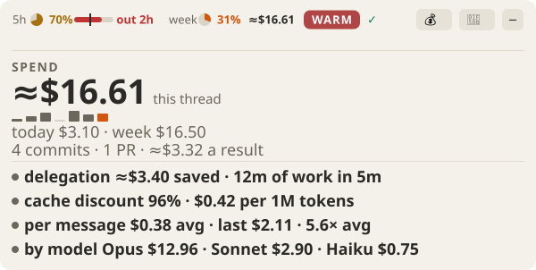
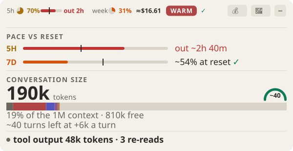
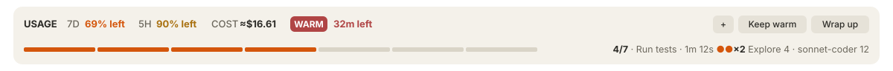
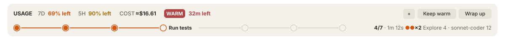

# spendometer

**Know where you stand while Claude works.** A band above the Claude Code prompt shows how much of
your usage you have used (as pies) and when it resets, what the conversation has cost, whether the prompt cache is
still warm, how far the current request has come, and which subagents are running. It also stops a
`git reset --hard` until you have seen what it would throw away.

<picture>
  <source media="(prefers-color-scheme: dark)" srcset="assets/band-capacity-1200-dark.svg">
  
</picture>

spendometer is a [Claude Code mod](https://code.claude.com/docs): it draws and listens, and calls no
model unless you turn on keep warm's pings or the brief coach. No setup, no keys, no account. Pictures in this README are mockups with example
numbers, shown in your GitHub theme.

## Install

One line in a terminal (bash, zsh or PowerShell 7):

```bash
claude plugin marketplace add spaldinga/spendometer && claude plugin install spendometer@spendometer
```

Then, in a Claude Code session that is already open, run `/reload-plugins --force` (a new session
picks it up by itself). That's it: the band appears above the prompt.

Or from inside Claude Code:

```
/plugin marketplace add spaldinga/spendometer
/plugin install spendometer@spendometer
/reload-plugins --force
```

No script is downloaded or run: both ways use Claude Code's own plugin commands. Needs Claude Code
2.1.287 or later; more under [Requirements](#requirements). In Windows PowerShell 5.1, use `;`
instead of `&&`.

## What you get

### Your limits, your cost and your cache, in one row

The row is always there, and on the desktop it is one row at every width: the 5-hour and 7-day limits, first as `/usage` lists them, each as a small pie of what is used with the percent used (the 5-hour one with a small pace track and when it runs out, or a ✓ when it lasts to its reset; the 7-day one with when it resets; on a narrow band: `5h ◔ 70%  week ◔ 31%`, then the pies and percents alone; the terminal has no pies and keeps its dots and percent left),
what this conversation has cost and what the last turn cost, and the prompt cache: Robo and `WARM` with the
minutes left, or `COLD` with what the next message will cost to re-cache, then a green ✓ while keep warm is on.
At the right end are the card's tabs and `+`/`−`. Hover a limit or the chip for the details.

### A card with the numbers behind it

Press a tab or `+` on the band (or type `/spendometer fold`) to open the card; press the tab in use again to close it. It shows one tab at a time, one per question: 💰 **Cost** and 🔋 **Capacity**, picked with the tab buttons before `−`, which are always shown (the emoji and the word on a wide band, the emoji alone on a narrow one; the one in use is the one not dimmed) or with `/spendometer tab cost|capacity`; the choice is kept, and the old names `overview` and `context` still work (they pick Cost and Capacity). **Cost** is the spend (this thread and the last seven days, with the commits and pull requests it made and what a result cost), delegation (what subagents saved), the cache discount (with a bar of what was read warm against written cold), the cost per message (red when the last one cost three times the average or more) and the cost by model. **Capacity** is the pace of each usage window against its reset (the bar is how much of the limit is used, red when it runs out before the reset; the tick is how much of the window's time has gone), then the conversation size as a stacked bar with a gauge of the turns left, and the tool output (tokens by tool, with the files that were read again unchanged). What keeping the cache warm costs is the hover of the WARM/COLD chip. A zone with no column of its own becomes one status line below.

**Wide.** Cost: SPEND, DELEGATION and CACHE DISCOUNT as columns, per message and by model as lines. (Capacity, wide, is the picture at the top.)

<picture>
  <source media="(prefers-color-scheme: dark)" srcset="assets/band-cost-1200-dark.svg">
  
</picture>

**Narrow.** The compact row (the short names, the tabs as emoji), and one column: the rest of the tab becomes status lines.

<picture>
  <source media="(prefers-color-scheme: dark)" srcset="assets/band-cost-600-dark.svg">
  
</picture>
<picture>
  <source media="(prefers-color-scheme: dark)" srcset="assets/band-capacity-600-dark.svg">
  
</picture>

The pictures are drawn from the mod's own card code with example numbers (`bash assets/mockups.sh assets`).

### Progress you can read at a glance, in six styles

While Claude works through a task list, the band shows how far it has come, the step in progress,
and the subagents running. Pick a style with `/spendometer progress <id>`; the choice is kept for every
session.

**`comet`** (default): a comet streaks to the current step and sets it ringing.

<picture>
  <source media="(prefers-color-scheme: dark)" srcset="assets/theme-comet-dark.svg">
  
</picture>

**`calm`**: one quiet segment per step, the current one breathing. The least motion.

<picture>
  <source media="(prefers-color-scheme: dark)" srcset="assets/theme-calm-dark.svg">
  
</picture>

**`vitals`**: a monitor pen writes each finished step as a heartbeat; a heart beats at the step in
progress.

<picture>
  <source media="(prefers-color-scheme: dark)" srcset="assets/theme-vitals-dark.svg">
  
</picture>

**`bridge`**: a starship console, every step a labelled panel, the active one blinking.

<picture>
  <source media="(prefers-color-scheme: dark)" srcset="assets/theme-bridge-dark.svg">
  
</picture>

**`wake`**: the step names as breadcrumbs, riding a wave that swells under the current step.

<picture>
  <source media="(prefers-color-scheme: dark)" srcset="assets/theme-wake-dark.svg">
  
</picture>

**`dial`**: every step a dial that fills like a clock hand; full dials are done.

<picture>
  <source media="(prefers-color-scheme: dark)" srcset="assets/theme-dial-dark.svg">
  
</picture>

### A second look before git throws work away

When Claude runs `git reset --hard`, a discarding `git checkout` or `git restore`, a forced
`git clean` or a force push, spendometer holds it and shows what would be lost. Nothing runs until you
press **Proceed**.

<picture>
  <source media="(prefers-color-scheme: dark)" srcset="assets/hold-dark.svg">
  
</picture>

### Keep the cache warm

- **Keep warm** (built in; uninstall [cache-tax](https://github.com/karanb192/cache-tax) if you have it): a status mark, per conversation, on by default. It keeps the
  prompt cache alive for 24 hours after each of your messages (every message starts the 24 hours again), so coming back after a break doesn't re-pay for the
  whole context. While it is on, the pace's green ✓ shows right after the WARM/COLD chip; off, nothing shows. It is a mark, not a button. When the cache goes cold (the computer slept or was off, so nothing could ping) the mark goes, and your next message brings it back. Type `/keepwarm on` over a cold cache to warm it now with one ping (about the price of a re-write). Hover the chip to see what keeping warm costs an hour and what it has saved. To let a finished conversation go cold, type `/keepwarm off`.

## What it shows

| Part | What you see | Where it comes from |
|---|---|---|
| **Usage** | 5-hour and 7-day limits as small pies with percent used and reset time (the terminal: dot bars and percent left); `LOW` under 15% left | Claude Code's own rate-limit figures |
| **Prompt cache** | `WARM` with minutes left, or `COLD` with the idle time and what the next message costs to re-cache. The tabs open a card: Cost (what is spent in this conversation and the last seven days, what subagents saved, the cache discount, the cost per message and by model) and Capacity (how fast each usage window is being used against its reset, the context size and free room with the turns left and, while cold, what re-caching costs, and the tool output). Hover a usage window or the chip for the limit and reset time, the minutes left, and what keeping warm costs and has saved | A clock from the last main-thread request, one hour long |
| **Progress** | Six styles to choose from (comet by default), with the count and the step in progress | The task list Claude already keeps, or the `progress` tool (below) |
| **Activity** | With no task list: each style's working animation and `working · 4 steps · 1m 12s` | Turn events |
| **Subagents** | One small orange dot per running subagent, `×2 Explore 4, sonnet-coder 12` | Subagent start, request and finish events |
| **Cost** | `COST ≈$12.40 · last $0.35`: the conversation so far and the latest turn | Token counts per finished turn at list prices |

## What it does

- **Keep warm mark** (built in). One state per conversation, driven by the typed `/keepwarm`; the band only shows it. It is on
  by default. With it on, every turn that reached the cache holds a window of 24 hours from then, so each message
  starts the 24 hours again; while the window is open and the cache is warm, a short ping goes out 50 minutes after
  your last request, so the cache is read, not re-written, when you come back. The band shows the green ✓ while the cache is warm and
  this conversation's switch is on (or a one-off window is open), else nothing: `/keepwarm off` turns the switch off and stops the
  window, and the conversation stays off until `/keepwarm on`; a message does not turn it back on. A computer that
  is off or asleep cannot ping, so the cache can still go cold overnight: keep warm then stops with `the cache went
  cold` and the mark goes, like the COLD chip. That is not turning it off: the next message re-writes the cache, brings the
  mark back and starts the pings again. `/keepwarm on` while the cache is cold sends one ping at once to warm it (its cost
  is a re-write) and opens 24 hours; if it cannot, one line in the transcript says why.
  `/keepwarm` or `/keepwarm on` (switch on, 24h), `90m` / `1h30m` (a one-off window), `always` (on for this and new
  conversations), `off` (off for this and new conversations, window stopped), `status` (time left, next ping, last ping).
  `/spendometer keepwarm [on | off | status | 90m | always]` does the same, and `/spendometer status` has a
  `keepwarm:` line.
  A ping that fails or finds the cache gone stops the window and says why.
  Before a send that would re-write a cold cache of 50,000 tokens or more, one line says what it will cost.
  With cache-tax installed spendometer stays passive (no pings, no button) and says so once: uninstall it with
  `claude plugin uninstall cache-tax@claude-code-mods`.
- **Hold for risky git commands.** When Claude runs `git reset --hard`, a `git checkout` or
  `git restore` that discards changes, a forced `git clean`, or a force push, through the Bash or
  PowerShell tool, spendometer holds the call and shows what it would lose (files, untracked paths,
  or the commits a force push would drop) with **Cancel** and **Proceed**.
- **A `progress` tool** Claude can call to report steps on a request it keeps no task list for.
- **Brief coach** (a trial, off by default). Turned on with `/spendometer coach on`, the first prompt of each
  conversation (and the first after `/clear` or a compaction) is scored by a small Haiku call: which of goal, why,
  constraints, done when and what to reuse it covers, with a question for each part that is missing. The answer is
  one line in the transcript, a hint for next time: the prompt is sent at once and never held, and a call that fails
  shows nothing. **Turning it on costs one small model call per first prompt** (about a tenth of a cent), billed to
  your plan or API key; `/spendometer coach status` shows the total.

## Requirements

- Claude Code 2.1.287 or later (mods load by default from that version).
- `git` on your `PATH`, for the hold.
- Keep warm is built in. Uninstall cache-tax (`claude plugin uninstall cache-tax@claude-code-mods`): installed, it
  pings too, and spendometer stays passive.

Built and used on Windows 11 in the Claude desktop app, in dark and light themes. See
[Limitations](#limitations) for what that means elsewhere.

## Other ways to install

From a local clone:

```bash
git clone https://github.com/spaldinga/spendometer.git
claude plugin marketplace add ./spendometer
claude plugin install spendometer@spendometer --scope user
```

If you have the original `ribbon` mod installed, uninstall it first: both draw the same band.

Remove it with `/plugin uninstall spendometer@spendometer`.

## Settings

```
/spendometer fold           open or close the cache card from the keyboard
/spendometer cost           print this conversation's cost
/spendometer progress       list the progress row themes (comet, calm, vitals, bridge, wake, dial)
/spendometer progress dial  draw the progress row as dials (default: comet; also calm, vitals, bridge, wake)
/spendometer hold off       stop holding risky git commands (default: on)
/spendometer coach on       score the first prompt of each conversation (default: off; one Haiku call each)
/spendometer coach status   briefs scored, how the share covered moved, and what the calls cost
/spendometer                show the settings and the width the band was drawn at
```

Keep warm shows in the band as a green ✓ while on, saved per conversation (on until `/keepwarm off`; a typed `/keepwarm always|off` sets the default for new conversations). Other settings are saved for every session.

## How it works

- **No model calls.** Everything is read from events Claude Code already raises: rate limits,
  turn and subagent events, tool calls. The exceptions are yours to trigger: the Keep warm mark
  (its pings cost a few cents each) and the brief coach, off until you turn it on (one small Haiku call per first
  prompt; the prompt goes in the call fenced as data to score, nothing else from the conversation).
- **Progress without tokens.** The bar follows the task-list tool calls Claude makes
  (`TodoWrite`, the Task tools, the desktop app's plan). The text bar counts a step in progress as half; the drawn bar
  pulses the step in progress and turns it solid when it lands.
- **Cost is an estimate, not a bill.** Each finished turn's tokens are priced from a built-in
  list-price table (input, output, cache reads, cache writes at the 1-hour rate) and kept per
  session, so the total survives a restart.
- **The hold reads the command's text and asks only git.** Every measurement is a git command
  with paths passed as arguments, never through a shell. Cancel, no answer in ten minutes, or an
  interrupted turn refuse the command and tell Claude why. If the hold itself fails, the command
  runs as usual with a note in the transcript: it is a second look, not a lock.

## Limitations

- **Light and dark themes.** The band's text uses the app's own text colours, so it follows the theme.
  The drawings (the card, Robo, the chip, the progress line) are painted in the dark palette and carry a
  light-scheme override, so they follow the system's light/dark setting, not the app's theme setting. That
  the app passes the system setting on to a drawing is a hypothesis until it is checked in the app; if it
  does not, the drawings stay dark.
- **The hold is not a permission system.** It does not see commands inside `bash -c "..."`,
  scripts or aliases, and it only knows the git commands listed above. Use
  [permission rules](https://code.claude.com/docs/en/settings) for a hard block.
- **The cache state is a clock, not a server check.** It assumes a one-hour cache lifetime.
- **Prices are a table in the code** (`hooks/cache-art.ts`) and go stale when list prices change.
  A model the table does not know adds nothing to the cost.
- **Only one mod can draw the band.** spendometer takes the whole band above the prompt, so another
  mod that draws there will not show.
- **The `progress` tool is always listed**, which adds its short description to every request.
- **On managed (Team/Enterprise) installs**, some session events never reach user-installed mods.
  spendometer is built around that, but a resumed conversation shows no cache state until its first
  reply.
- Tested by its own test suite and by daily use on one Windows machine. The terminal layout and
  macOS/Linux are covered by tests only.

## Develop

```bash
claude plugin test .       # the test suite; no login needed
claude plugin validate .   # manifest and hook checks
claude --plugin-dir .      # try it for one session
```

```
hooks/
  register.tsx       hooks and the band
  cache-art.ts       colours (dark and light), prices, the cache card and the robot
  metrics.ts         the card's metric row: hit rate, runway, outlier (pure)
  progress.ts        task list and report tracking (pure)
  progress-art.ts    the calm progress line, the sweep and the subagent dots
  progress-themes.ts the progress styles: comet, calm, vitals, bridge, wake, dial
  pace.ts            each usage window's pace against its reset (pure)
  days.ts            spend per day across sessions (pure)
  layout.ts          which layout fits the band (pure)
  guard.ts           risky git commands: classify and measure
  font.ts            Outfit, embedded so the drawings render anywhere
tests/               one file per area
types/index.d.ts     the mod's state
```

`AGENTS.md` has the working notes for coding agents.

## Credits

spendometer is a fork of [ribbon](https://github.com/robonuggets/ribbon) by Jay E (RoboNuggets),
which provides the usage bars, the cache card and Robo, the robot. Ideas and behaviour also come
from:

- [cache-tax](https://github.com/karanb192/cache-tax) by Karan Bansal: keep-warm. spendometer's pinger in
  `hooks/keepwarm.ts` is ported from it (MIT, see the table below), so cache-tax is no longer needed.
- [savvy-progress](https://github.com/JohnnyVizz/claude-kit/tree/main/plugins/savvy-progress) by
  JohnnyVizz: the idea of a progress bar and a subagent display above the prompt.
- [Blast Radius](https://github.com/anthropics/claude-code-playground/tree/main/claude-code/mods/blast-radius)
  by Anthropic: holding a risky command and showing what it would change. spendometer's git
  measurements follow it.

## License

MIT, see [LICENSE](LICENSE). Copyright (c) 2026 Jay E | RoboNuggets for the original ribbon;
Copyright (c) 2026 Alexander Spalding for the changes in this fork, under the same licence.

Third-party material:

| What | From | Licence |
|---|---|---|
| The band, usage bars, cache card, Robo and their tests | [ribbon](https://github.com/robonuggets/ribbon), Copyright (c) 2026 Jay E \| RoboNuggets | MIT, in [LICENSE](LICENSE) |
| Parts of `hooks/safety/guard/guard.ts`: how risky git commands are measured and reported | [Blast Radius](https://github.com/anthropics/claude-code-playground/tree/main/claude-code/mods/blast-radius), Copyright 2026 Anthropic PBC | Apache-2.0, in [LICENSES/Apache-2.0.txt](LICENSES/Apache-2.0.txt); the changes are listed at the top of the file |
| The keep-warm pinger in `hooks/keepwarm.ts`: its timing, retries and race handling, and the rule for "a ping kept the cache warm" | [cache-tax](https://github.com/karanb192/cache-tax), Copyright (c) 2026 Karan Bansal | MIT |
| The embedded font | [Outfit](https://github.com/Outfitio/Outfit-Fonts) | SIL Open Font License 1.1 |

[savvy-progress](https://github.com/JohnnyVizz/claude-kit/tree/main/plugins/savvy-progress)
(MIT, Copyright (c) 2026 johnnyvizz) inspired the progress bar and the subagent display; no code
from it is included.

Not affiliated with Anthropic or with the projects credited above.
